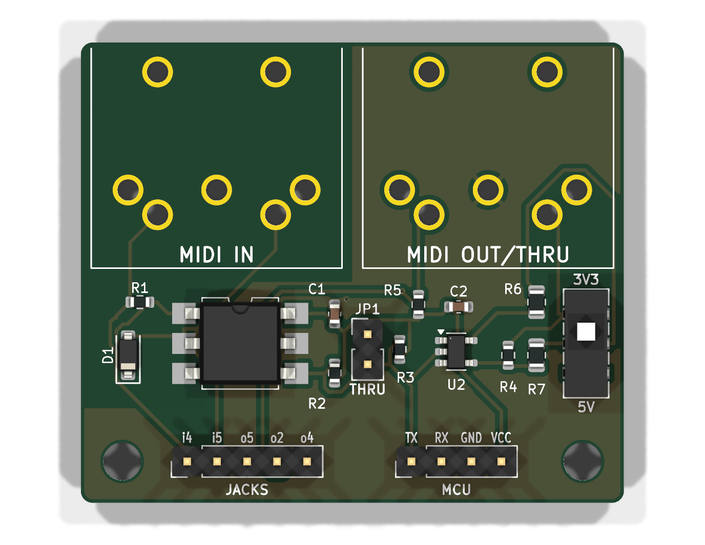

# MIDI IN/OUT 3V3/5V

A small MIDI interface board: opto-isolated MIDI IN, buffered MIDI OUT, optional hard THRU,
a 3V3/5V slide switch, and on-board footprints for two right-angle DIN-5 jacks.



Board: 46 x 39 mm, 2 layers, all SMD parts on top, 2x M3 mounting holes.

## Ordering at JLCPCB

Everything to upload is in `jlcpcb/`:

| File | Where |
|---|---|
| `midiboard-gerbers.zip` | PCB order: "Add gerber file" |
| `midiboard-BOM.csv` | PCB Assembly step: BOM |
| `midiboard-CPL.csv` | PCB Assembly step: CPL / pick & place |

1. Upload the gerber zip. Defaults are fine (2 layers, 1.6 mm, any colour/finish).
   For "Mark on PCB" choose **Remove Mark** (there is no order-number placeholder on the board).
2. Enable **PCB Assembly**, Economic, **Top side**.
3. Upload BOM and CPL. All 13 placed parts should match automatically:

   | Ref | Value | Package | LCSC | Type |
   |---|---|---|---|---|
   | U1 | H11L1SM optocoupler (onsemi) | SMD DIP-6 | C899473 | extended |
   | U2 | 74LVC1G17W5-7 Schmitt buffer | SOT-23-5 | C151394 | extended |
   | D1 | 1N4148W | SOD-123 | C81598 | basic |
   | SW1 | C&K JS202011JCQN DPDT slide switch | SMD | C221665 | extended |
   | R1, R4, R5 | 220 R | 0603 | C22962 | basic |
   | R2 | 470 R | 0603 | C23179 | basic |
   | R3 | 10 k | 0603 | C25804 | basic |
   | R6 | 33 R | 0805 | C17634 | basic |
   | R7 | 10 R | 0805 | C17415 | basic |
   | C1, C2 | 100 nF X7R | 0603 | C14663 | basic |

4. In the placement preview, check the pin-1 dots: U1 pin 1 is top-left (towards R1/D1), U2 pin 1 is
   top-left (silkscreen triangle). The CPL already applies the KiCad-to-JLCPCB rotation offsets
   (-90 deg for SOT-23-5 and SMD DIP-6).

### Hand-soldered (not in the JLCPCB BOM)

| Ref | Part | Note |
|---|---|---|
| J1, J2 | DIN-5 female, right angle, PCB mount: Legion/Haoyu **DIN-504**, LCSC **C23689428** | Any CUI SDS-50J-footprint jack fits |
| J3 | 1x4 pin header 2.54 mm | MCU side |
| J4 | 1x5 pin header 2.54 mm | Only if you use panel-mount jacks instead of J1/J2 |
| JP1 | 1x2 pin header 2.54 mm + jumper cap | HARD THRU selector |

The DIN jacks can also be added to the JLCPCB order as through-hole assembly if you prefer.

## Pins

**J3 - MCU** (3.3 V or 5 V logic, set SW1 to match)

| Pin | Name | Connect to |
|---|---|---|
| 1 | TX | MCU UART TX (31250 baud) |
| 2 | RX | MCU UART RX |
| 3 | GND | GND |
| 4 | VCC | 3.3 V or 5 V supply, same as the MCU logic level |

**J4 - panel jacks**: `i4`/`i5` to MIDI IN pins 4/5, `o5`/`o2`/`o4` to MIDI OUT pins 5/2/4.
These are wired in parallel with the on-board J1/J2 footprints.

**SW1 3V3 / 5V**: slide towards the jacks (`3V3`) for a 3.3 V MCU, towards the headers (`5V`) for a 5 V MCU.
It only sets the MIDI OUT drive; RX simply swings to VCC. A wrong setting is not harmful: 5 V on the 3V3
setting pushes ~15 mA into the receiver, 3.3 V on the 5V setting gives ~3 mA, which some receivers may not
detect.

**JP1 HARD THRU** (2-pin header, open by default): fit a 2.54 mm jumper cap to echo MIDI IN straight to the OUT jack.
When bridged, leave J3 TX unconnected.

## Circuit notes

- MIDI IN: 220 R + 1N4148W reverse protection into an H11L1 (rated 3-16 V), open-collector output pulled up
  to VCC by 470 R. Accepts 3.3 V and 5 V senders (current loop, ~5-8 mA). IN jack pin 2 is left unconnected and there is no ground copper on the IN side, so the
  input stays galvanically isolated as the MIDI spec requires.
- MIDI OUT: 74LVC1G17 buffer (1.65-5.5 V). 5V position: 220 R from VCC to pin 4 and 220 R in series with
  pin 5 (MIDI 1.0). 3V3 position: SW1 adds 33 R and 10 R in parallel, giving 28.7 R and 9.6 R (CA-033 asks
  for 33 R / 10 R; 33 R is the nearest JLCPCB basic part, ~7 mA instead of ~6.7 mA).
  10 k pull-up on TX keeps the output idle when TX is not driven.

## Verification

`build.sh` runs all of these and stops on failure:

- KiCad ERC on the schematic (0 errors).
- `scripts/check_netlist.py`: the schematic netlist matches `scripts/design.py`.
- KiCad DRC with schematic parity (0 unconnected, 0 parity issues, no clearance errors).
- `scripts/check_gerbers.py`: rasterizes the copper gerbers, joins layers through the drill file's plated
  holes, and derives connectivity from copper alone, then compares it with `design.py` (opens, shorts and
  NC pads). Mutating the expected design makes it fail, so it does detect wiring errors.

Checked by hand against datasheets: H11L1 pinout and inverting output (onsemi), 74LVC1G17 SOT25 pinout
(Diodes Inc), JS202011 contact positions (C&K: slider towards pin 1 closes 1-2 and 4-5), DIN-504 PCB layout
(Legion and Haoyu drawings agree), and the JLCPCB/EasyEDA footprints of C899473, C151394, C81598 and C221665
for the CPL rotations and diode polarity.

`midiboard.kicad_dru` lets through-hole pads have a single thermal spoke per layer: they are plated through
both ground pours, so the connection is solid either way.

## Sources

KiCad project: `midiboard.kicad_pro` / `.kicad_sch` / `.kicad_pcb`, project footprint in `lib/midiboard.pretty`.
`jlcpcb/midiboard-schematic.pdf` is a printable schematic.

Everything is generated from `scripts/design.py` (parts, LCSC numbers, nets):

```
FREEROUTING_JAR=/path/to/freerouting-2.1.0.jar ./build.sh
```

`build.sh` generates the schematic, runs ERC, checks the schematic netlist against `design.py`, places the
board, autoroutes it with Freerouting (headless), adds the ground pours, runs DRC with schematic parity and
writes the JLCPCB files, then checks the gerber copper. It needs KiCad 7 `pcbnew` Python, `kiutils`, numpy,
scipy, pillow, gerbv, Java 21 and a KiCad >= 8 `kicad-cli` (defaults to the KiCad Flatpak).

## License

Copyright (c) 2026 Marc Lainez. Licensed under
[Creative Commons Attribution-ShareAlike 4.0 International](https://creativecommons.org/licenses/by-sa/4.0/)
(CC BY-SA 4.0), see `LICENSE`.
